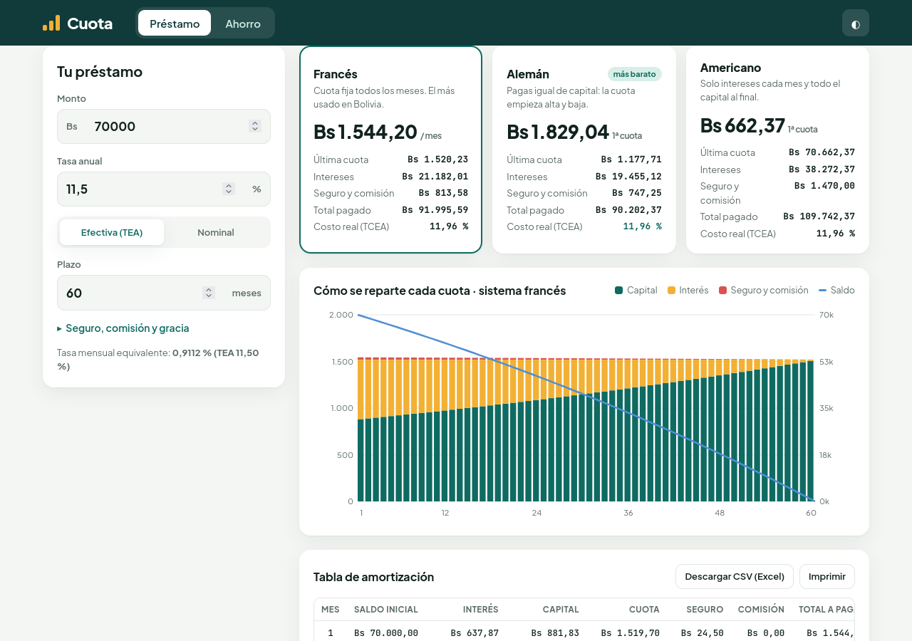
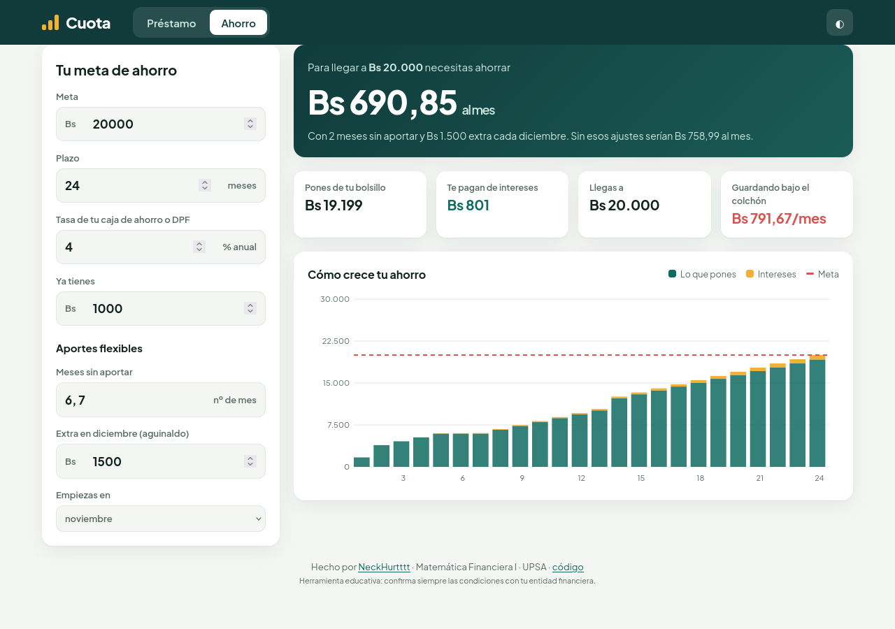
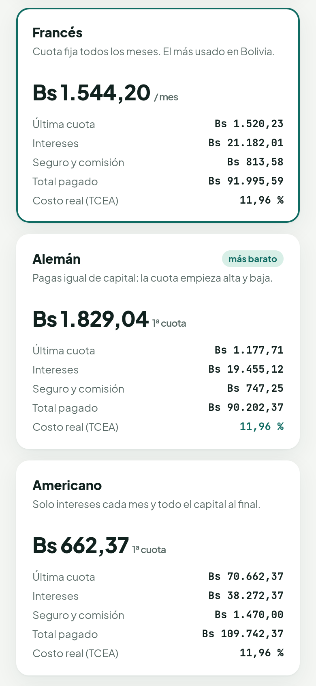

<div align="center">


### ¿Cuánto vas a pagar de verdad? ¿Cuánto tienes que ahorrar al mes? En bolivianos y sin letra chica.

<a href="https://neckhurtttt.github.io/cuota/"></a>
<a href="#english"></a>




</div>

## 💸 Qué hace

**Cuota** es una calculadora de **Matemática Financiera** pensada para Bolivia (montos en Bs). Tiene dos partes:

### 🏦 Préstamo

- Compara al mismo tiempo los sistemas **francés** (cuota fija), **alemán** (capital fijo) y **americano** (solo intereses y capital al final), y marca cuál sale más barato.
- Acepta tasa **efectiva anual (TEA)** o **nominal** capitalizable mensualmente y muestra la tasa mensual equivalente.
- Suma **seguro de desgravamen** (sobre el saldo), **comisión** por cuota y **meses de gracia**.
- Calcula el **costo real (TCEA)** con la TIR de los flujos: lo que de verdad te cuesta el crédito con todo incluido.
- Gráfico de cada cuota (capital, interés, seguro) con el saldo que baja, y **tabla de amortización** completa para **descargar en CSV** (se abre en Excel) o imprimir.

### 🐷 Ahorro (aportes flexibles)

- Le dices tu **meta**, el **plazo**, la tasa de tu caja de ahorro o DPF y lo que ya tienes.
- Te dice **cuánto ahorrar al mes** para llegar.
- Es **flexible**: marcas los meses en que no vas a poder aportar y cuánto pones extra con el **aguinaldo** de diciembre, y recalcula.
- Muestra cuánto pones tú, cuánto te pagan de intereses y cómo crece mes a mes.

<table>
<tr>
<td width="62%"></td>
<td width="38%"></td>
</tr>
</table>

## 🧮 Fórmulas

| | |
|---|---|
| Tasa mensual desde la TEA | `i = (1 + TEA)^(1/12) − 1` |
| Nominal → efectiva | `TEA = (1 + j/12)^12 − 1` |
| Cuota francesa | `C = P · i / (1 − (1 + i)^−n)` |
| Alemán | `amortización = P / n`, `interés = saldo · i` |
| Americano | `cuota = P · i`, y en la última `P + P · i` |
| TCEA | TIR mensual de `[P, −total₁, …, −totalₙ]`, anualizada: `(1 + TIR)^12 − 1` |
| Aporte para una meta | `A = (M − S₀(1 + i)^n) · i / ((1 + i)^n − 1)` |

Con aportes flexibles no hay fórmula cerrada: la app simula mes a mes y busca el aporte por bisección.

## ▶️ Usar

**En línea:** https://neckhurtttt.github.io/cuota/

```sh
python3 -m http.server 8000   # http://localhost:8000
npm test                      # 9 pruebas (Node 20+)
```

Los datos que pones quedan en el enlace (`#…`), así que puedes **compartir tu cálculo** copiando la URL.

## 🗂️ Estructura

- `js/fin.js`: la matemática pura (tasas, tablas, TIR, ahorro). La prueban `tests/fin.test.js`, con casos conocidos como 10.000 al 1 % mensual en 12 meses = 888,49.
- `js/app.js`: formularios, gráficos SVG, CSV y enlace para compartir.
- `css/app.css`: diseño claro y oscuro, adaptable al celular.

> Herramienta educativa de la materia **Matemática Financiera I** (UPSA). Las condiciones reales las define cada entidad financiera.

<a id="english"></a>
## 🌎 English

**Cuota** is a loan and savings calculator in Bolivian bolivianos. It compares **French** (fixed payment), **German** (fixed principal) and **American** (interest-only) amortization side by side, supports effective or nominal annual rates, credit insurance, fees and grace months, computes the **true annual cost (APR via IRR)**, and exports the full schedule to CSV. The savings planner finds the monthly deposit to reach a goal, even with **skipped months and a December bonus**. Pure HTML/CSS/JS, [try it online](https://neckhurtttt.github.io/cuota/).

<div align="center">

**Hecho por [NeckHurtttt](https://github.com/NeckHurtttt)** · Matemática Financiera I · UPSA · Santa Cruz, Bolivia 🇧🇴

<sub>capital · interés · saldo · repetir</sub>

</div>
